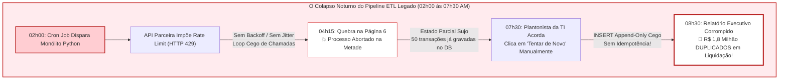
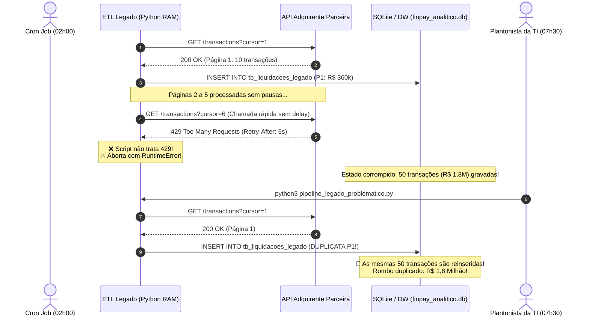
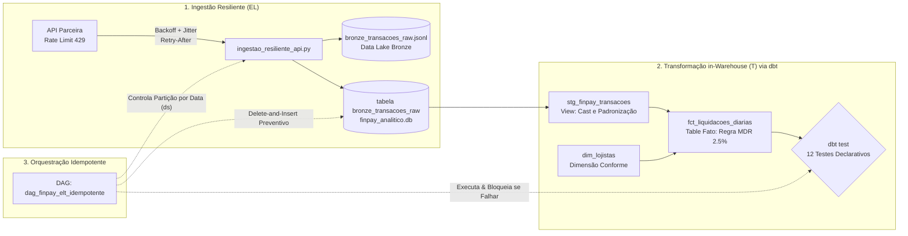

# Laboratório Prático Aula 07: O Paradigma ETL vs. ELT e Ferramentas Modernas

**FUCAPE Business School**  
**Curso:** Graduação em Ciência de Dados para Negócios  
**Disciplina:** Modelagem Informacional  
**Professor:** Prof. Dr. Wagner Perin  

---

## O Colapso Noturno da *FinPay & OmniTrade*: Da Fragilidade do ETL ao Resgate com ELT Resiliente

A **FinPay & OmniTrade** é uma joint-venture entre um marketplace de escala nacional e uma instituição de pagamentos. A plataforma intermedia mais de 250.000 transações financeiras diárias entre 50.000 lojistas credenciados, realizando a conciliação bancária de bandeiras de cartão com múltiplos adquirentes parceiros (Cielo, Stone, Rede).

Para consolidar os relatórios diários de liquidação financeira e faturamento exigidos pelo Banco Central e pelo comitê executivo, a equipe herdou um **pipeline monolítico legado construído há quatro anos sob o paradigma ETL tradicional**.

Durante a última virada de mês, o pipeline enfrentou uma **catástrofe de conciliação financeira de R$ 1,8 milhão**:



### Aprendizagem Construtiva (*Inquiry-Based Learning*)
Neste laboratório, você não começará consumindo teorias abstratas ou códigos prontos. Aplicaremos a metodologia do **Conflito Cognitivo Guiado**:
1. **Fase 1 (Vivenciando a Dor):** Você executará o pipeline monolitico legado, verá o travamento imediato por `HTTP 429 Too Many Requests`, simulará o retry manual de produção e usará consultas SQL forenses para diagnosticar a duplicação catastrófica de **R$ 1,8 milhão** na conta dos lojistas.
2. **Fase 2 (Construindo a Solução Resiliente):** Você projetará a nova esteira sob o paradigma **ELT Moderno**:
   - Ingestão tolerante a falhas com **Exponential Backoff e Full Jitter**;
   - Camada Bronze bruta (*Data Lake / Raw Storage*);
   - Modelagem modular e contratos declarativos de dados com **`dbt`** (*Staging, Marts e Data Tests*);
   - Orquestração com **Apache Airflow** sob estratégia estrita de **Idempotência** (*Delete-and-Insert* por partição temporal).
3. **Fase 3 (Do Mock para o Mundo Real):** Você analisará desafios de escala corporativa (efeito manada, filas de Dead Letter Queue, Change Data Capture e FinOps de computação em nuvem).

---

## Estrutura do Repositório

```text
repositorio_aula07/
├── simulador_api_parceira.py          # Gateway simulador de API com Rate Limit (HTTP 429)
├── pipeline_legado_problematico.py    # Pipeline ETL monolítico com falhas de rede e duplicação
├── diagnostico_duplicatas.sql         # Auditoria forense SQL do rombo de R$ 1,8 milhão
├── ingestao_resiliente_api.py         # Extrator ELT com Exponential Backoff e Full Jitter
├── executar_pipeline_dbt.py           # Motor de compilação, execução e testes de qualidade dbt
├── dbt_project/                       # Projeto Analytics Engineering (dbt)
│   ├── dbt_project.yml                # Configurações do projeto e materializações
│   └── models/
│       ├── schema.yml                 # Contratos de dados: unique, not_null, relationships
│       ├── staging/
│       │   └── stg_finpay_transacoes.sql # Camada Staging: tipos, cast e padronização
│       └── marts/
│           ├── dim_lojistas.sql          # Dimensão conforme de lojistas credenciados
│           └── fct_liquidacoes_diarias.sql# Tabela Fato: cálculo de taxa MDR e repasse
├── dags/
│   └── dag_finpay_elt_idempotente.py  # DAG Apache Airflow com prova formal de Idempotência
├── docker-compose.yml                 # Infraestrutura opcional com Apache Airflow + PostgreSQL
├── README.md                          # Roteiro didático do laboratório
└── Solucao_Laboratorio.md             # Guia pedagógico com gabarito e saídas esperadas
```

---

## Fase 1: O Monólito Quebrado (Vivenciando a Dor)

### 1.1 Compreendendo a Falha Arquitetural do ETL Tradicional
No ETL legado, o script tenta:
1. Fazer requisições contínuas em laço fechado para a API de conciliação;
2. Transformar os dados diretamente na memória RAM do servidor (cálculo de taxas, formatação);
3. Gravar na tabela `tb_liquidacoes_legado` do banco via `INSERT` cego sem chaves de unicidade e sem tratamento de partição.



---

### 1.2 Roteiro de Execução Passo a Passo da Fase 1

Abra o terminal no diretório deste repositório e execute os comandos abaixo na ordem indicada:

#### Passo 1: Executar o Pipeline Legado pela 1ª Vez (Simulando a Madrugada)
```bash
python3 pipeline_legado_problematico.py
```
> **O que observar no terminal:**  
> O script processará as páginas 1 a 5 com sucesso, acumulando 50 transações e R$ 1.800.000,00 no banco. Na página 6, a API devolverá `HTTP 429 Too Many Requests`. Como o script legado não possui lógica de backoff, o processo quebra imediatamente na metade do lote.

#### Passo 2: Executar o Pipeline Legado pela 2ª Vez (Simulando o Retry Manual às 07h30)
```bash
python3 pipeline_legado_problematico.py
```
> **O que observar no terminal:**  
> Sem validação de duplicidade ou limpeza prévia, o script insere novamente as páginas 1 a 5 no banco antes de quebrar novamente no Rate Limit. O total de linhas sobe para 100 e o volume financeiro acumulado dobra para R$ 3.600.000,00!

#### Passo 3: Executar a Auditoria Forense do Rombo Contábil
```bash
sqlite3 finpay_analitico.db < diagnostico_duplicatas.sql
```

---

### 1.3 Provocações Socráticas e Diagnóstico da Dor

Analise a saída do script `diagnostico_duplicatas.sql` e reflita criticamente com sua equipe:

> **Provocação Socrática 1 (Rede e Vazão):**  
> *"Por que colocar um simples `time.sleep(1)` estático ou tentar de novo imediatamente após receber um HTTP 429 é uma péssima decisão de engenharia em ambientes distribuídos com dezenas de instâncias?"*  
> *(Pense em: Thundering Herd Problem, bloqueio de IP por WAF e desobediência ao cabeçalho RFC 6585).*

> **Provocação Socrática 2 (Projeção de Escala Contábil):**  
> *"Neste teste didático com 100 linhas, o rombo foi de R$ 1,8 milhão. Em um marketplace nacional com 250.000 transações diárias e R$ 150 milhões transacionados por dia, qual seria o tamanho da perda de caixa se o financeiro realizasse a TED de liquidação automática para os lojistas às 08h00 da manhã?"*

> **Provocação Socrática 3 (Acoplamento do ETL Clássico):**  
> *"No ETL legado, onde os dados brutos originais foram salvos? Se a diretoria solicitar a auditoria do cabeçalho da requisição ou o recálculo com novas alíquotas tributárias de 3 meses atrás, isso é possível?"*

---

## Fase 2: O Resgate com Arquitetura ELT Resiliente

Para eliminar em definitivo os colapsos da FinPay, projetamos a moderna arquitetura **ELT (*Extract, Load, Transform*)**:



---

### 2.1 Roteiro de Execução Passo a Passo da Fase 2

#### Passo 1: Ingestão Resiliente com Exponential Backoff e Full Jitter
Execute o extrator resiliente da Camada Bronze:
```bash
python3 ingestao_resiliente_api.py
```
> **O que observar no terminal:**  
> O extrator requisita as páginas 1 a 5. Ao atingir o cursor 6, ele detecta o `HTTP 429`, lê o cabeçalho `Retry-After: 5`, calcula o recuo exponencial somado ao ruído aleatório (*Jitter* de ~5.5s), aguarda pacificamente e reexecuta com êxito!  
> Ele extrai todas as 10 páginas (100 transações = R$ 3,5 milhões), salvando o payload bruto em `bronze_transacoes_raw.jsonl` e na tabela Bronze do SQLite.

#### Passo 2: Executar a Modelagem Modular e Testes de Qualidade com `dbt`
Execute a compilação e validação dos modelos analíticos:
```bash
python3 executar_pipeline_dbt.py
```
> **O que observar no terminal:**  
> 1. **`dbt run`:** Compila e materializa a view `stg_finpay_transacoes`, a tabela `dim_lojistas` e a tabela fato `fct_liquidacoes_diarias`.  
> 2. **`dbt test`:** Executa **12 testes de integridade declarativos** (`unique`, `not_null`, `accepted_values`, `relationships`), garantindo 100% de conformidade com contratos de dados.  
> 3. Exibe o demonstrativo financeiro auditado sem duplicações: **R$ 3.500.000,00 faturados** e **R$ 87.500,00 de receita MDR retida**.

#### Passo 3: Provar a Idempotência Estrita com Apache Airflow
Execute a simulação oficial da DAG do Airflow:
```bash
python3 dags/dag_finpay_elt_idempotente.py
```
> **O que observar no terminal:**  
> A rotina simula **duas execuções consecutivas** da mesma DAG para a partição temporal `2026-10-07`.  
> Graças à estratégia **Delete-and-Insert particionado**, a segunda execução limpa preventivamente a partição antes de recarregar.  
> **Resultado:** O estado final permanece idêntico ($f(f(x)) = f(x)$), com **ZERO duplicatas** e valor estritamente preservado!

---

### 2.2 Análise dos Contratos Declarativos de Dados (`schema.yml`)

Observe a elegância do arquivo [`dbt_project/models/schema.yml`](file:///home/wagnerperin/fucape/disciplinas/modelagem-informacional/01_planos_de_aulas/repositorio_aula07/dbt_project/models/schema.yml):

```yaml
version: 2
models:
  - name: fct_liquidacoes_diarias
    description: "Tabela Fato contendo as liquidações financeiras aprovadas com taxa MDR."
    columns:
      - name: id_transacao
        tests:
          - unique
          - not_null
      - name: vlr_liquido_lojista
        tests:
          - not_null
      - name: id_lojista
        tests:
          - not_null
          - relationships:
              to: ref('dim_lojistas')
              field: id_lojista
```

> [!IMPORTANT]
> **Por que isso é revolucionário?**  
> Em vez de escrever dezenas de scripts manuais de checagem em Python, o engenheiro analítico declara as regras de negócio em YAML. Se uma transação vier sem lojista ou duplicada, o teste quebra na esteira de CI/CD ou bloqueia a DAG do Airflow **antes** que o dado chegue aos dashboards da diretoria!

---

## Matriz Comparativa Definitiva: ETL Clássico vs. ELT Moderno

| Dimensão de Comparação | ETL Tradicional (Legado FinPay) | ELT Moderno (Modern Data Stack) |
| :--- | :--- | :--- |
| **Local de Transformação** | Servidor intermediário (EC2, Pandas, RAM finita). | Motor de dados analítico MPP (Snowflake, BigQuery, DuckDB). |
| **Momento da Carga (*Load*)** | No final, após cálculos pesados e filtros rígidos. | Imediatamente após a extração bruta (Camada Bronze). |
| **Preservação do Dado Bruto** | Descartado. Impossível auditar ou recalcular o passado. | Preservado 100% em formato imutável (JSONL/Parquet/Raw). |
| **Tolerância a Rate Limit** | Chamadas cegas -> Bloqueio HTTP 429 e quebra de job. | Exponential Backoff com Full Jitter e leitura de `Retry-After`. |
| **Garantia de Idempotência** | Inexistente. Reexecuções duplicam linhas e valores. | Nativa via *Delete-and-Insert* por `{{ ds }}` ou *Merge/Upsert*. |
| **Governança e Testes** | Scripts ad-hoc espalhados sem padronização. | Contratos declarativos no `schema.yml` (`dbt test`). |
| **Impacto de Schema Drift** | Quebra total do monólito se uma coluna mudar. | Resiliente: payload salvo como JSON bruto na Bronze. |

---

## Fase 3: Do Mock para o Mundo Real (Desafios Corporativos)

### 3.1 Subindo o Ambiente Corporativo com Docker Compose (Opcional)
Se desejar executar a interface visual completa do **Apache Airflow 2.8** integrado a um banco **PostgreSQL 16**, execute:

```bash
# Iniciar os serviços em segundo plano
docker compose up -d

# Visualizar o status dos contêineres
docker compose ps
```
- Acesse a interface web do Airflow em: `http://localhost:8080`
- Credenciais padrão: Usuário `admin` | Senha `admin`
- Localize a DAG: `dag_finpay_elt_idempotente` e dispare manualmente para observar a execução dos operadores no grafo visual!

Para encerrar os contêineres:
```bash
docker compose down
```

---

### 3.2 Desafios para as Próximas Aulas e Escala de Produção

1. **O Problema do Efeito Manada (*Thundering Herd Problem*):**  
   Se 50 microsserviços caírem juntos por volta de 03h00 e todos tiverem retry configurado para exatamente 5 segundos, todos baterão na API do parceiro exatamente às 03h00m05s. Por que o **Jitter** (ruído aleatório estocástico) é a única vacina matemática contra esse colapso?
2. **Dead Letter Queue (DLQ):**  
   Quando um registro na API vem corrompido de forma irreversível (ex: payload malformado que causa HTTP 400), o pipeline deve abortar o lote inteiro de 100.000 clientes ou isolar a linha corrompida em uma fila de exceção (DLQ) para não paralisar o faturamento?
3. **Change Data Capture (CDC) vs. Ingestão em Lotes (*Batch*):**  
   Conforme a FinPay expande para 2 milhões de transações diárias, extrair via API RESTful noturna torna-se inviável dentro da janela de processamento (*batch window*). Como ferramentas de CDC (ex: Debezium, Kafka) transformam essa ingestão em um fluxo contínuo de eventos (*Streaming ELT*)?

---

> [!TIP]
> **Preparação para a Prova A2:**  
> Revise com atenção a diferença de posicionamento da etapa de transformação entre ETL e ELT, a sintaxe da macro `{{ ref() }}` do dbt, os 4 testes nativos do `schema.yml` e o conceito matemático de **Idempotência** ($f(f(x)) = f(x)$). Esses tópicos serão cobrados na seção prática e teórica da avaliação!
