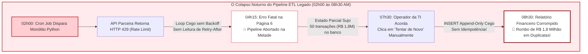
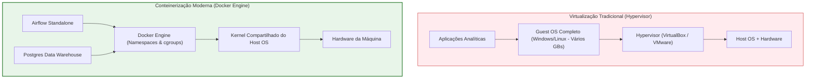
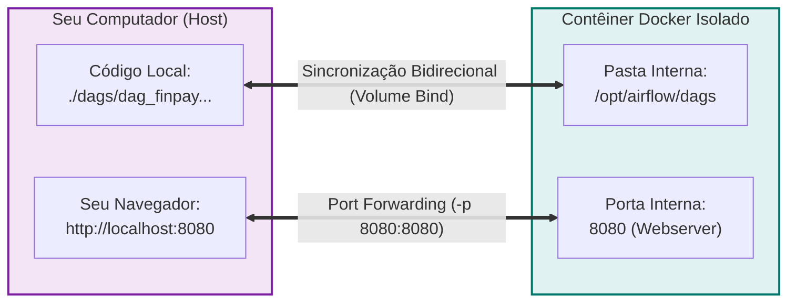
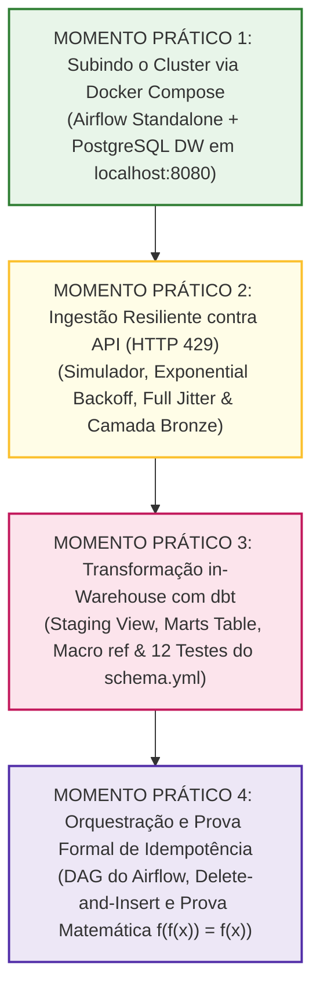
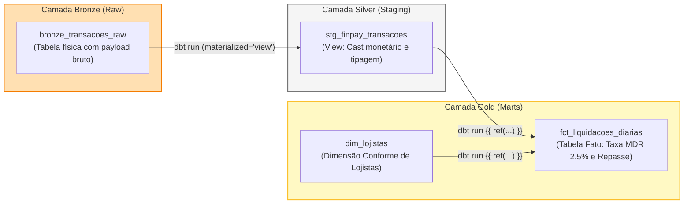
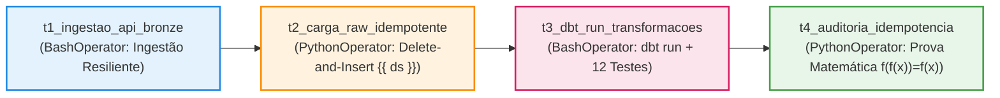

# Laboratório Prático Imersivo: Docker, dbt e Orquestração Idempotente com Apache Airflow

**FUCAPE Business School**  
**Curso:** Graduação em Ciência de Dados para Negócios  
**Disciplina:** Modelagem Informacional (Aula 09)  
**Professor:** Prof. Dr. Wagner Perin  
**Carga Horária:** 4 h/a (200 minutos de imersão de bancada hands-on)

---

## 1. Apresentação Executiva da Missão: O Resgate da FinPay & OmniTrade

A **FinPay & OmniTrade** é uma joint-venture entre um marketplace nacional e uma fintech adquirente que intermedia 250.000 transações financeiras diárias entre 50.000 lojistas credenciados, conciliando cartões com Cielo, Stone e Rede.

Na última virada de mês, a esteira de dados corporativa colapsou:
1. **04h15 AM:** O pipeline monolítico legado (ETL tradicional) travou ao receber `HTTP 429 Too Many Requests` do gateway adquirente parceiro por falta de controle de taxa.
2. **07h30 AM:** O operador noturno tentou reexecutar o script manualmente. Como a carga operava em modo *Append-Only* cego sem nenhuma garantia de idempotência, as 50 primeiras transações foram gravadas novamente.
3. **08h30 AM:** A tesouraria e a diretoria financeira depararam-se com um rombo contábil de **R$ 1,8 milhão** em liquidações indevidas a favor de lojistas.
4. **09h00 AM:** Quando o time tentou reproduzir a falha localmente, surgiu o pesadelo: *"Na minha máquina funciona, mas no servidor quebrou!"* (conflito de versões de bibliotecas e ausência de banco de metadados).



### O Esquadrão de Data SRE da FUCAPE
Neste laboratório de 4 horas, as duplas de Ciência de Dados para Negócios assumem o comando do **Esquadrão de Engenharia e Confiabilidade de Dados (Data SRE)**. A missão:
- **Padronizar o ambiente** do zero com Docker e Docker Compose, eliminando de vez o *"na minha máquina funciona"*;
- **Subir um cluster analítico completo** integrando Apache Airflow 2.8.1 e PostgreSQL 16 Data Warehouse;
- **Implementar ingestão resiliente** com algoritmo de *Exponential Backoff com Full Jitter*;
- **Transformar dados in-Warehouse com `dbt`**, validando **12 contratos declarativos de dados** no `schema.yml`;
- **Disparar e auditar uma DAG idempotente** no Airflow que assegure $f(f(x)) = f(x)$, garantindo ZERO centavos duplicados mesmo após múltiplas reexecuções consecutivas.

---

## 2. Guia Docker do Zero para Cientistas e Gestores de Dados

> [!NOTE]
> Se você nunca utilizou Docker antes, não se preocupe! Esta seção explica os conceitos fundamentais de maneira direta e intuitiva para o perfil de negócios.

### 2.1 Por que o Docker é Essencial? (Virtualização Tradicional vs. Contêineres)
No passado, para isolar aplicações, criavam-se **Máquinas Virtuais (VMs)** via Hypervisor (VirtualBox, VMware). Cada VM exigia a instalação de um sistema operacional completo (*Guest OS*), pesando dezenas de gigabytes, demorando minutos para inicializar e consumindo gigabytes de memória RAM.

O **Docker** adota uma abordagem revolucionária: a **conteinerização em nível de sistema operacional**. Ele não cria um sistema operacional novo; ele isola processos compartilhando o próprio Kernel da máquina hospedeira (*Host OS*), utilizando mecanismos nativos do Linux chamados *namespaces* (isolamento de processos, redes e arquivos) e *cgroups* (controle de limite de CPU e RAM).



### 2.2 Os Quatro Pilares do Docker
Para operar o Docker com maestria, você só precisa dominar quatro conceitos:

1. **Imagem (*Image*):** É o modelo imutável, a "receita de bolo" pronta da aplicação (como uma classe em Programação Orientada a Objetos). Exemplos: `postgres:16-alpine` ou `apache/airflow:2.8.1-python3.10`.
2. **Contêiner (*Container*):** É a instância viva da imagem em execução (como o objeto instanciado na memória). Pode ser iniciado, pausado, reiniciado ou destruído em segundos sem alterar o molde original.
3. **Volumes (*Data Volumes / Bind Mounts*):** Contêineres são efêmeros por natureza (se o contêiner for destruído, tudo que estava gravado dentro dele desaparece). Um **Volume** cria uma ponte direta entre uma pasta do seu computador real e uma pasta interna do contêiner. Isso permite que você edite uma DAG no VS Code do seu host e o Airflow dentro do contêiner veja a alteração em tempo real!
4. **Mapeamento de Portas (*Port Forwarding / Binding*):** O contêiner vive em uma rede privada isolada. Para que o navegador do seu computador consiga abrir a interface web do Airflow, criamos um redirecionamento de porta `-p 8080:8080` (qualquer requisição que chegar na porta 8080 do seu computador será encaminhada para a porta 8080 do contêiner).



### 2.3 Tabela de Comandos Essenciais do Docker Compose
O `docker-compose` gerencia múltiplos contêineres a partir de um único arquivo descritivo (`docker-compose.yml`):

| Comando | Finalidade Prática | Quando Utilizar |
| :--- | :--- | :--- |
| `docker compose up -d` | Baixa as imagens e inicia todos os serviços em segundo plano (*detached mode*). | No início do laboratório para subir o cluster. |
| `docker compose ps` | Lista os contêineres ativos, portas mapeadas e status de integridade (*healthy*). | Para checar se Airflow e PostgreSQL estão saudáveis. |
| `docker compose logs -f [serviço]` | Exibe o fluxo contínuo de logs no terminal (*follow*). Pressione `Ctrl + C` para sair. | Para inspecionar a inicialização e mensagens de erro. |
| `docker compose down` | Para e remove contêineres e redes, liberando 100% da CPU e RAM do host. | No final da aula para deixar a máquina limpa. |
| `docker compose down -v` | Remove os contêineres **E** destrói os volumes persistidos no disco. | Apenas quando desejar resetar o banco de dados do zero. |

---

## 3. Estrutura de Arquivos do Repositório

```text
repositorio_aula09/
├── docker-compose.yml                 # Manifesto de infraestrutura (Airflow 2.8.1 + PostgreSQL 16)
├── simulador_api_parceira.py          # Gateway simulador de API com Rate Limit (HTTP 429)
├── pipeline_legado_problematico.py    # Pipeline ETL monolítico (conflitos: erro e duplicações)
├── diagnostico_duplicatas.sql         # Relatório forense SQL auditoria do rombo de R$ 1,8 milhão
├── ingestao_resiliente_api.py         # Extrator ELT com Exponential Backoff e Full Jitter
├── executar_pipeline_dbt.py           # Motor de compilação Jinja, execução e 12 testes do dbt
├── dbt_project/                       # Projeto Analytics Engineering (dbt)
│   ├── dbt_project.yml                # Configurações do projeto e materializações
│   └── models/
│       ├── schema.yml                 # 12 Contratos declarativos de dados
│       ├── staging/
│       │   └── stg_finpay_transacoes.sql # View: limpeza, cast monetário e padronização
│       └── marts/
│           ├── dim_lojistas.sql          # Dimensão conforme de lojistas credenciados
│           └── fct_liquidacoes_diarias.sql# Tabela Fato: cálculo da taxa MDR (2.5%) e repasse
├── dags/
│   └── dag_finpay_elt_idempotente.py  # DAG Apache Airflow com prova formal de Idempotência
├── logs/                              # Logs de execução do Airflow mapeados pelo volume
├── plugins/                           # Plugins customizados do Airflow
├── Solucao_Laboratorio.md             # Guia com saídas esperadas e gabarito
└── README.md                          # Este guia prático e completo
```

---

## 4. O Roteiro dos 4 Momentos Práticos de Bancada



---

### MOMENTO PRÁTICO 1: Subindo o Cluster Airflow + PostgreSQL via Docker Compose

#### Passo 1.1: Navegar até o repositório no terminal
Abra o terminal integrado do VS Code ou seu emulador de terminal Linux/Mac/WSL:
```bash
cd ./repositorio_aula09
pwd
```

#### Passo 1.2: Inicializar o cluster conteinerizado
Execute o comando de subida em segundo plano:
```bash
docker compose up -d
```
*O que o Docker está fazendo nos bastidores:*
1. Cria a rede isolada interna do cluster;
2. Cria o volume persistente `finpay_postgres_dw_data`;
3. Sobe o contêiner `finpay_postgres_dw` e aguarda o healthcheck (`pg_isready`);
4. Sobe o contêiner efêmero `finpay_airflow_init` que roda as migrações do banco e cria o usuário `admin`;
5. Sobe o contêiner permanente `finpay_airflow_standalone` contendo o Webserver e o Scheduler unificados.

#### Passo 1.3: Checar o status dos contêineres
```bash
docker compose ps
```
*Saída esperada:*
```text
NAME                        IMAGE                           STATUS                    PORTS
finpay_airflow_standalone   apache/airflow:2.8.1-python3.10 Up (healthy)              0.0.0.0:8080->8080/tcp
finpay_postgres_dw          postgres:16-alpine              Up (healthy)              0.0.0.0:5432->5432/tcp
```

#### Passo 1.4: Inspecionar os logs do Airflow
```bash
docker compose logs -f airflow-standalone
```
*(Aguarde até visualizar a mensagem de que o Webserver está pronto em `http://0.0.0.0:8080`. Para sair do log contínuo, pressione `Ctrl + C`).*

#### Passo 1.5: Acessar a Web UI no navegador
1. Abra seu navegador web (Chrome, Firefox ou Edge);
2. Acesse a URL: **`http://localhost:8080`**;
3. Faça login com as credenciais padrão:
   - **Username:** `admin`
   - **Password:** `admin`
4. Você verá a interface visual moderna do Apache Airflow 2.8.1.

> [!TIP]
> **🏆 CHECKPOINT 1 DE BANCADA:** Chame o professor para inspecionar a tela do seu navegador com a Web UI do Airflow conectada e o terminal exibindo os contêineres com status `Up`.

---

### MOMENTO PRÁTICO 2: Ingestão Resiliente contra API com Rate Limit (HTTP 429)

#### Passo 2.1: Vivenciar a Dor do Monolito Quebrado
Antes de construir a solução certa, vamos rodar o pipeline legado problemático para sentir a dor:
```bash
python3 pipeline_legado_problematico.py
```
*O que acontece no console:*
- As páginas 1 a 5 são requisitadas em disparada sem nenhum intervalo;
- Na página 6, a API parceira detecta mais de 5 requisições em 3 segundos e corta a conexão com **`HTTP 429 Too Many Requests`** e cabeçalho `Retry-After: 5`;
- O monolito legado quebra com `RuntimeError`, deixando 50 transações e R$ 1,8 milhão pendentes no banco.

Agora simule o operador da TI acordando às 07h30 e tentando reexecutar o mesmo script:
```bash
python3 pipeline_legado_problematico.py
```
*Resultado:*
O total de linhas na tabela `tb_liquidacoes_legado` sobe para **100** e o volume salta para **R$ 3,6 milhões**!

#### Passo 2.2: Auditoria Forense
Rode a auditoria SQL forense para visualizar o rombo contábil:
```bash
sqlite3 finpay_analitico.db < diagnostico_duplicatas.sql
```
Observe o diagnóstico: 50 transações duplicadas, gerando R$ 1.800.000,00 a mais em faturamento fantasma e R$ 1.755.000,00 em pagamentos indevidos aos lojistas!

#### Passo 2.3: Ingestão Resiliente com Exponential Backoff e Full Jitter
Abra e inspecione o arquivo `ingestao_resiliente_api.py`. Observe a fórmula de recuo:
$$\text{backoff} = \min(\text{max\_delay}, \text{base\_delay} \times 2^{\text{tentativa}-1}) + \text{jitter}$$
Se a API retornar o cabeçalho `Retry-After: 5`, o extrator aguarda no mínimo 5 segundos com ruído estocástico, evitando o *Thundering Herd Problem* (Efeito Manada).

Execute o extrator moderno:
```bash
python3 ingestao_resiliente_api.py
```
*O que observar no console:*
```text
Requisitando página cursor=5 (Tentativa 1/5)...
Requisitando página cursor=6 (Tentativa 1/5)...
⚠️  [ALERTA 429] Rate limit atingido no cursor 6! Cabeçalho detectado: Retry-After = 5s.
   Aplicando Exponential Backoff + Full Jitter: aguardando 5.55 segundos...
Requisitando página cursor=6 (Tentativa 2/5)...
Requisitando página cursor=7 (Tentativa 1/5)...
...
🏆 INGESTÃO CONCLUÍDA COM SUCESSO!
Total de transações capturadas: 100 transações brutas (10 páginas completas)
Volume financeiro bruto capturado: R$ 3,500,000.00
Camada Bronze persistida: bronze_transacoes_raw.jsonl e tabela SQLite/DW
```

> [!TIP]
> **🏆 CHECKPOINT 2 DE BANCADA:** Exiba ao professor a mensagem de log demonstrando a autocura após o `HTTP 429` e a geração intacta do arquivo `bronze_transacoes_raw.jsonl` com 100 registros brutos.

---

### MOMENTO PRÁTICO 3: Transformação in-Warehouse e Contratos de Dados com `dbt`

#### Passo 3.1: Entendendo a Arquitetura em Camadas (ELT Moderno)
No paradigma ELT Moderno:
- Não processamos dados pesados na memória RAM do script Python;
- Carregamos os dados brutos na **Camada Bronze** (`bronze_transacoes_raw`);
- O **`dbt`** compila modelos modulares em SQL puro e executa dentro do próprio motor do banco de dados analítico.



#### Passo 3.2: O Superpoder da Macro `{{ ref() }}` e o `schema.yml`
Abra o arquivo `dbt_project/models/marts/fct_liquidacoes_diarias.sql`. Note que não há referências a esquemas físicos fixos de banco. O `dbt` utiliza `{{ ref('stg_finpay_transacoes') }}` e `{{ ref('dim_lojistas') }}` para inferir a ordem exata de compilação do grafo!

Abra `dbt_project/models/schema.yml` e confira a especificação dos **12 testes declarativos de qualidade**:
- **`unique`:** Garante que a chave primária nunca duplique;
- **`not_null`:** Garante que campos essenciais nunca fiquem nulos;
- **`accepted_values`:** Garante que apenas segmentos e status autorizados entrem na base;
- **`relationships`:** Garante integridade referencial estrita entre a Fato e a Dimensão;
- **`positive_values`:** Garante que valores monetários e taxas sejam estritamente positivos.

#### Passo 3.3: Compilar e Executar os Modelos e os 12 Testes do dbt
Execute o motor analítico:
```bash
python3 executar_pipeline_dbt.py
```
*Saída validada no console:*
```text
==============================================================================
  MOTOR DBT: EXECUTANDO MODELOS DE TRANSFORMAÇÃO (dbt run)
==============================================================================
1/3 Compilando View: stg_finpay_transacoes ........ [OK em 0.00s]
2/3 Compilando Table: dim_lojistas ................ [OK em 0.00s]
3/3 Compilando Table: fct_liquidacoes_diarias ..... [OK em 0.00s]

==============================================================================
  MOTOR DBT: EXECUTANDO TESTES DE QUALIDADE (dbt test)
==============================================================================
[PASS] Teste 01: stg_finpay_transacoes.id_transacao (unique)
[PASS] Teste 02: stg_finpay_transacoes.id_transacao (not_null)
[PASS] Teste 03: dim_lojistas.id_lojista (unique)
[PASS] Teste 04: dim_lojistas.id_lojista (not_null)
[PASS] Teste 05: dim_lojistas.categoria (accepted_values)
[PASS] Teste 06: fct_liquidacoes_diarias.id_transacao (unique)
[PASS] Teste 07: fct_liquidacoes_diarias.id_transacao (not_null)
[PASS] Teste 08: fct_liquidacoes_diarias.vlr_liquido_lojista (not_null)
[PASS] Teste 09: fct_liquidacoes_diarias.id_lojista (not_null)
[PASS] Teste 10: fct_liquidacoes_diarias.id_lojista -> dim_lojistas (relationships)
[PASS] Teste 11: fct_liquidacoes_diarias.vlr_transacao_brl (positive_values)
[PASS] Teste 12: fct_liquidacoes_diarias.vlr_taxa_mdr_finpay (positive_values)

Relatório Financeiro Auditado:
• Transações aprovadas: 100
• Volume Total Faturado: R$ 3,500,000.00
• Receita Própria MDR (2.5%): R$ 87,500.00
• Repasse Líquido Lojistas: R$ 3,412,500.00
```

> [!TIP]
> **🏆 CHECKPOINT 3 DE BANCADA:** Mostre ao professor os **12 testes declarativos** passando com status `[PASS]` e os números consolidados batendo perfeitamente no centavo.

---

### MOMENTO PRÁTICO 4: Orquestração e Prova Formal de Idempotência no Airflow

#### Passo 4.1: A Estratégia Delete-and-Insert da DAG
Abra `dags/dag_finpay_elt_idempotente.py`. Observe o grafo de tarefas:
`t1_ingestao_api >> t2_carga_idempotente >> t3_dbt_run >> t4_auditoria`



Na tarefa `t2_carga_raw_idempotente`, antes de qualquer inserção, o Airflow executa:
```sql
DELETE FROM bronze_transacoes_raw WHERE SUBSTR(data_hora_utc, 1, 10) = '{{ ds }}';
```
Isso garante a **Idempotência Computacional Estrita**: reexecutar o fechamento de uma data contábil limpa previamente a partição e recarrega os dados com perfeição, sem duplicações!

#### Passo 4.2: Visualizar e Disparar na Web UI do Airflow
1. Vá até o navegador em `http://localhost:8080`;
2. Na lista de DAGs, localize **`dag_finpay_elt_idempotente`**;
3. Ative a DAG no botão de alternância (*Toggle On*);
4. Clique no botão de Play (**Trigger DAG**) no canto superior direito;
5. Clique no nome da DAG e abra a aba **Graph View**;
6. Acompanhe a transição das caixas de tarefas:
   - *queued* (cinza) $\rightarrow$ *running* (verde claro) $\rightarrow$ *success* (verde escuro).

#### Passo 4.3: Prova Matemática de Idempotência ($f(f(x)) = f(x)$)
No terminal, execute o runner de prova matemática que simula duas execuções consecutivas para a mesma janela contábil:
```bash
python3 dags/dag_finpay_elt_idempotente.py
```
*Saída validada no console:*
```text
==============================================================================
  SIMULAÇÃO LOCAL DA DAG DO AIRFLOW: TESTE FORMAL DE IDEMPOTÊNCIA
==============================================================================
Executando a DAG pela 1ª VEZ para a data lógica ds = '2026-10-07'...
[Airflow Task: carga_raw_idempotente] Processando partição lógica de dados: ds = 2026-10-07
  • Limpeza preventiva: 100 registros prévios expurgados para a partição 2026-10-07.
  • Carga concluída: 100 registros inseridos com sucesso na partição 2026-10-07.

[Airflow Task: auditoria_idempotencia] ✅ SUCESSO ABSOLUTO!
  • Total de liquidações aprovadas: 100
  • Volume bruto consolidado: R$ 3,500,000.00
  • Receita própria MDR (2.5%): R$ 87,500.00
  • Repasse líquido aos lojistas: R$ 3,412,500.00
  • Duplicatas detectadas: ZERO (Idempotência Estrita verificada: f(f(x)) = f(x))

------------------------------------------------------------------------------
Simulando REEXECUÇÃO da DAG (2ª VEZ) para a MESMA data ds = '2026-10-07'...
(Simula o plantonista da TI clicando em 'Clear / Retry' no Airflow)
------------------------------------------------------------------------------
[Airflow Task: carga_raw_idempotente] Processando partição lógica de dados: ds = 2026-10-07
  • Limpeza preventiva: 100 registros prévios expurgados para a partição 2026-10-07.
  • Carga concluída: 100 registros inseridos com sucesso na partição 2026-10-07.

[Airflow Task: auditoria_idempotencia] ✅ SUCESSO ABSOLUTO!
  • Total de liquidações aprovadas: 100
  • Volume bruto consolidado: R$ 3,500,000.00
  • Receita própria MDR (2.5%): R$ 87,500.00
  • Repasse líquido aos lojistas: R$ 3,412,500.00
  • Duplicatas detectadas: ZERO (Idempotência Estrita verificada: f(f(x)) = f(x))

==============================================================================
  🏆 PROVA MATEMÁTICA CONCLUÍDA:
     Total de transações duplicadas na Fato: ZERO
     Idempotência verificada: f(f(x)) = f(x)
     Mesmo após múltiplas reexecuções consecutivas para a mesma data lógica,
     o banco analítico contém exatamente as 100 transações válidas e R$ 3,5M!
==============================================================================
```

> [!TIP]
> **🏆 CHECKPOINT 4 DE BANCADA:** Apresente ao professor a tela do Airflow com todas as tarefas em verde (*success*) e o relatório no terminal comprovando ZERO duplicatas após reexecuções.

---

## 5. Encerramento da Sessão e Boas Práticas

Após concluir todos os checkpoints, encerre os serviços de forma elegante para liberar a memória RAM e a CPU do computador da faculdade:
```bash
docker compose down
```
*(Seus arquivos, modelos dbt, códigos de DAGs e dados persistidos no volume continuam guardados com segurança no seu disco).*

---

## 6. Seção de Solução de Problemas (*Troubleshooting*)

### 1. Conflito de Porta 8080 ou 5432 no Host
- **Sintoma:** Ao rodar `docker compose up -d`, o terminal exibe:  
  `Error response from daemon: driver failed programming external connectivity on endpoint ...: Bind for 0.0.0.0:8080 failed: port is already allocated`.
- **Causa:** Outro serviço (servidor web, Tomcat, Jenkins, Oracle XE ou PostgreSQL local) já está utilizando a porta 8080 ou 5432 na sua máquina física.
- **Como Resolver:**
  1. Descubra qual processo está usando a porta:
     ```bash
     sudo lsof -i :8080
     ```
  2. Finalize o processo ou, mais facilmente, altere o mapeamento de porta no arquivo `docker-compose.yml`:
     ```yaml
     ports:
       - "8081:8080"   # Acesse no navegador via http://localhost:8081
     ```

### 2. Docker Daemon não está rodando / Docker Desktop parado
- **Sintoma:** O comando `docker compose up` retorna:  
  `Cannot connect to the Docker daemon at unix:///var/run/docker.sock. Is the docker daemon running?`
- **Como Resolver:**
  - No Windows / macOS: Abra o aplicativo **Docker Desktop** e aguarde até o ícone da baleia ficar verde (*Engine Running*).
  - No Linux (Ubuntu/Debian): Inicie o serviço no terminal:
    ```bash
    sudo systemctl start docker
    sudo systemctl status docker
    ```

### 3. Falha de Memória ou Contêiner Fechando com Código 137 (`OOMKilled`)
- **Sintoma:** O contêiner `finpay_airflow_standalone` reinicia continuamente ou é encerrado com status `Exited (137)`.
- **Causa:** O Apache Airflow requer no mínimo 3 GB de memória RAM dedicada.
- **Como Resolver:**
  - No Docker Desktop: Acesse *Settings (Engrenagem) -> Resources -> Advanced* e aumente a alocação de memória RAM para pelo menos **4 GB**.
  - No WSL2 (Windows): Crie ou edite o arquivo `C:\Users\<SeuUsuario>\.wslconfig` e adicione:
    ```ini
    [wsl2]
    memory=4GB
    processors=2
    ```
    Depois execute no PowerShell: `wsl --shutdown` e reabra o terminal.

### 4. Permissões de Diretório no Linux / Mac
- **Sintoma:** O Airflow reclama que não consegue gravar arquivos em `/opt/airflow/logs` ou permissão negada em `finpay_analitico.db`.
- **Como Resolver:**
  O contêiner do Airflow utiliza o usuário interno com UID `50000`. Conceda permissão no diretório do projeto:
  ```bash
  sudo chown -R $USER:$USER .
  chmod -R 777 logs/
  ```

---

## 7. Referências e Leituras Recomendadas
- Apache Airflow Documentation: *Architecture Overview & Best Practices* (<https://airflow.apache.org/docs/>)
- dbt Core Documentation: *Model materializations and testing contracts* (<https://docs.getdbt.com/>)
- Marc Brooker (AWS): *Exponential Backoff And Jitter* (<https://aws.amazon.com/blogs/architecture/exponential-backoff-and-jitter/>)
- FUCAPE Business School: *Plano de Aula da Disciplina Modelagem Informacional (Prof. Wagner Perin)*.
